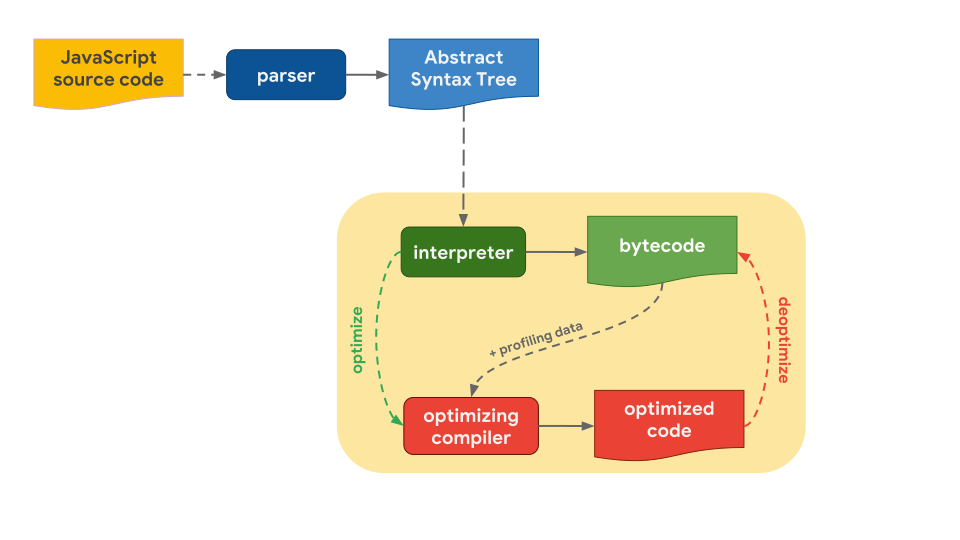
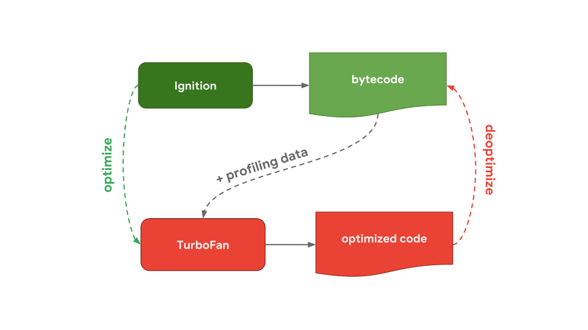
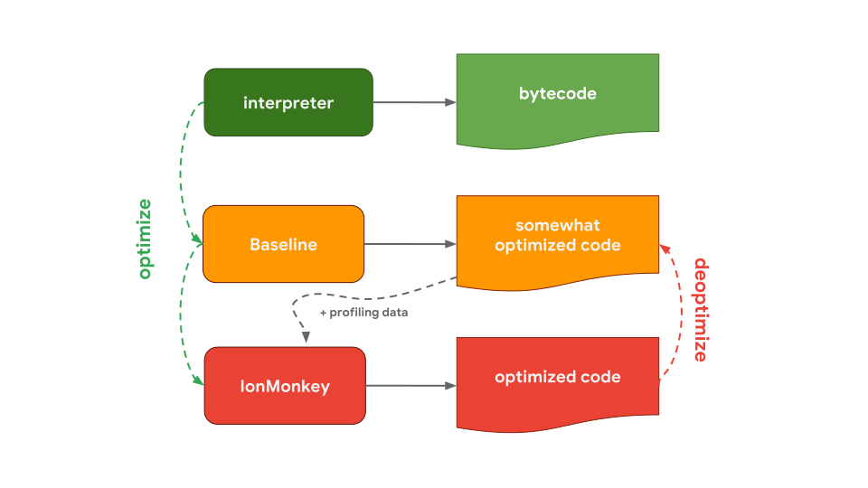
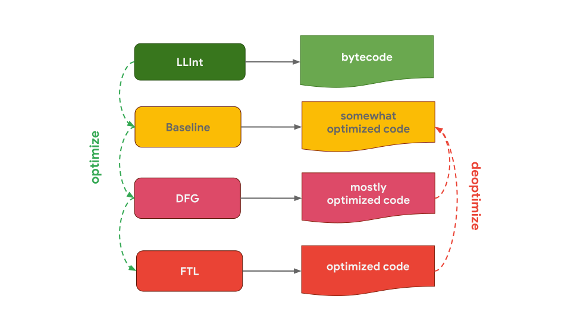
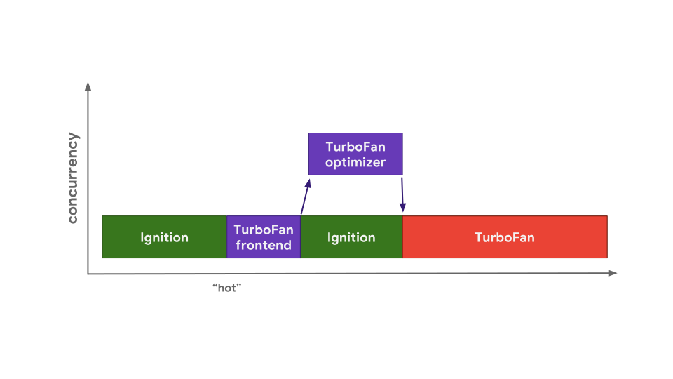
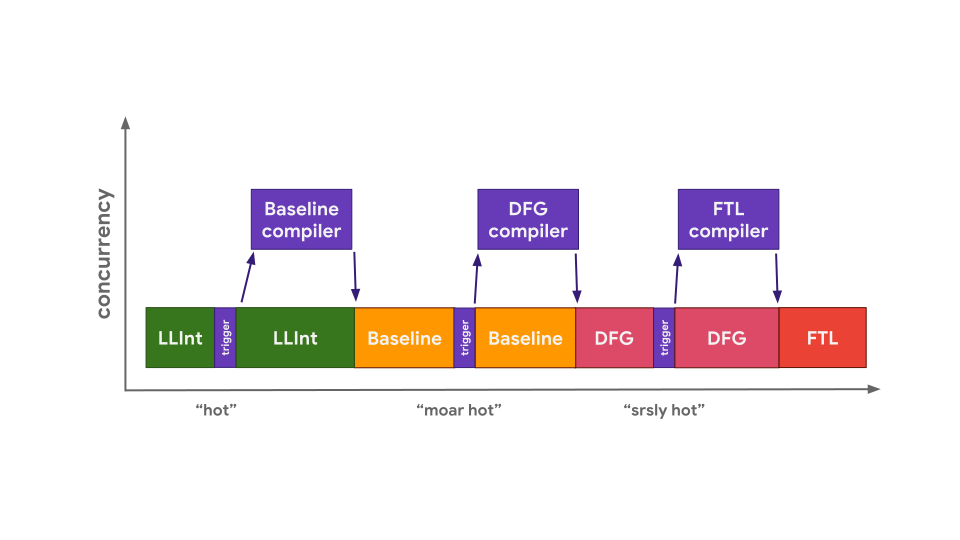

# レンダラの動作

レンダラプロセスの主な仕事は、HTML、CSS、JavaScript を、ユーザーが操作できるウェブページに変換することです。

## パース - DOM の構築

レンダラプロセスは HTML データを受け取り始めると、それを **D**ocument **O**bject **M**odel(DOM)に変換して、ページの内部表現を組み立て始めます。ブラウザはこのデータ構造と API も公開しており、ウェブ開発者は JavaScript を通じてそれを操作できます。

### サブリソースの読み込み

DOM のパースと同時に、「プリロードスキャナ」が並行して動き、参照されているリソースに対するネットワークリクエストを送ります。典型的な例は、`<link>` タグ内の `href` 属性や、`<script>` タグ・`` タグの `src` 属性です。

HTML パーサは `<script>` タグに達すると、パースを一時停止して JavaScript の読み込み、パース、実行を行わなければなりません。JavaScript は `document.write` などの機能で DOM のレイアウトを変更でき、DOM の構造が変わりうるからです。

## JavaScript の実行

JavaScript はパースされて、[抽象構文木](https://en.wikipedia.org/wiki/Abstract_syntax_tree)(Abstract Syntax Tree, AST)に変換されます。次に**インタプリタ**が AST を使って**バイトコード**を生成し、それを実行します。この時点で、エンジンは JavaScript コードを実行しています。

JavaScript を高速に実行するために、バイトコードを**最適化コンパイラ**に送ることがあります。最適化コンパイラは、持っている**プロファイリングデータ**に基づいて、いくつかの仮定を置きます。そして、その仮定を使って高度に最適化された機械語を生成します。仮定のひとつが誤っていたと判明した場合、最適化コンパイラは**脱最適化(deoptimize)**して、インタプリタによる実行に戻ります。

<figure><figcaption>
出典: Mathias Bynens, <a href="https://mathiasbynens.be/notes/shapes-ics">https://mathiasbynens.be/notes/shapes-ics</a>
</figcaption></figure>

対象とする JavaScript エンジンによって、下部の実行部分の見た目は変わります。2021 年までの V8 は、まさに次のような形でした。

<figure><figcaption>
出典: Mathias Bynens, <a href="https://mathiasbynens.be/notes/shapes-ics">https://mathiasbynens.be/notes/shapes-ics</a>
</figcaption></figure>

V8 の JavaScript インタプリタは **Ignition** と呼ばれ、最適化コンパイラは [**Turbofan**](../an-introduction-to-turbofan/) です。Turbofan はこのあとすぐ登場します。


2021 年から、V8 にはエンジン内にもうひとつ**最適化を行わない**コンパイラ、[Sparkplug](https://v8.dev/blog/sparkplug) が加わりました。Sparkplug は、バイトコードを驚くほど高速に機械語へ変換し、わずかな高速化を得るように設計されています。\
2023 年には、V8 に最適化コンパイラの [Maglev](https://v8.dev/blog/maglev) が追加されました。これは Sparkplug と Turbofan の中間に位置します。


Firefox の SpiderMonkey エンジンには 2 つのコンパイラがあり、一方がもう一方より最適化が強力です。

<figure><figcaption>
出典: Mathias Bynens, <a href="https://mathiasbynens.be/notes/shapes-ics">https://mathiasbynens.be/notes/shapes-ics</a>
</figcaption></figure>

一方、Apple の WebKit が使う JavaScriptCore エンジンには、最適化コンパイラが **3 つ**あり、それぞれ最適化の度合いが異なります。

<figure><figcaption>
出典: Mathias Bynens, <a href="https://mathiasbynens.be/notes/shapes-ics">https://mathiasbynens.be/notes/shapes-ics</a>
</figcaption></figure>

複数のコンパイラが何の役に立つのかを理解するために、各段階がいつ働き始めるかを説明している [WebKit のドキュメント](https://docs.webkit.org/Deep%20Dive/JSC/JavaScriptCore.html)を見てみましょう。

* **Baseline JIT** は、関数が 6 回以上呼び出された場合、またはループを 100 回以上回った場合(あるいはその組み合わせ。たとえば 3 回の呼び出しで合計 50 回のループ反復)に働き始めます
* **DFG JIT** は、関数が 60 回以上呼び出された場合、またはループを 1000 回以上回った場合に働き始めます
* **FTL JIT** は、関数が数千回呼び出された場合、またはループを数万回回った場合に働き始めます

ドキュメントには、これらの数値は概算であり、追加のヒューリスティックにも基づいていると明記されています。LLInt と Baseline はどちらもプロファイリング情報を収集するので、関数の使用頻度が **DFG** の水準に達したときには、**投機**を行うのに十分な情報が揃っています。DFG と FTL は、仮定が崩れたときにどちらも Baseline へ脱最適化できます。投機についてのさらなる説明は [Turbofan 入門](../an-introduction-to-turbofan/)を見てください。

結局のところ、関数がどれだけ**ホット**か(どれだけの回数、どれだけの頻度で呼ばれるか)に応じて、異なる最適化器が使われます。2021 年以前の V8 は、Ignition での実行がある段階に達すると、別スレッドで Turbofan 最適化器を起動していました。

<figure><figcaption>
出典: Mathias Bynens, <a href="https://mathiasbynens.be/notes/prototypes">https://mathiasbynens.be/notes/prototypes</a>
</figcaption></figure>

JavaScriptCore も似た動作をしますが、それを 3 段階で行います。

<figure><figcaption>
出典: Mathias Bynens, <a href="https://mathiasbynens.be/notes/prototypes">https://mathiasbynens.be/notes/prototypes</a>
</figcaption></figure>

なぜエンジンによって最適化の段階が異なるのでしょうか。[Mathias Bynens](https://mathiasbynens.be/notes/prototypes) は次のように説明しています。

> JavaScript エンジンに複数の最適化段階がある理由は、インタプリタのように_コードを素早く生成する_ことと、最適化コンパイラのように_高速なコードを生成する_ことの間に、根本的なトレードオフがあるからです。これは連続的な尺度であり、最適化段階を増やすと、複雑さとオーバーヘッドが増える代わりに、より細かい判断ができるようになります。さらに、最適化の度合いと、生成されるコードのメモリ使用量の間にもトレードオフがあります。だから JavaScript エンジンは、**ホット**な関数だけを最適化しようとするのです。
