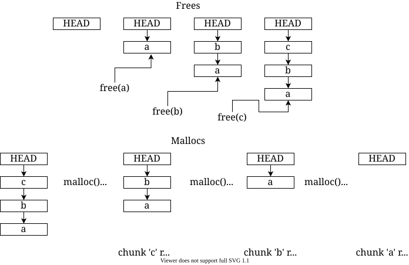

# fastbin の動作

fastbin はチャンクの単方向リンクリストです。目的は、非常に小さいチャンクを素早く効率的に再利用することです。そのために、fastbin サイズのチャンクは**統合されません**(解放されても、周囲の解放済みチャンクに吸収されません)。

fastbin は LIFO(Last-In-First-Out、後入れ先出し)の構造で、最後に bin に追加されたチャンクが最初に取り出されます。glibc が管理しているのは、リストの先頭のチャンクを指す HEAD **だけ**です(fastbin が空なら `0` になります)。fastbin 内のすべてのチャンクは `fd` ポインタを持ち、bin 内の次のチャンクを指します(最後のチャンクなら `0` です)。

新しくチャンクを解放すると、リストの**先頭**に追加されます(そのチャンクが head になります)。

* 解放されたチャンクの `fd` が、それまでの head を指すように上書きされます
* HEAD がこの新しいチャンクを指すように更新され、新しいチャンクがリストの head になります

実際に見てみましょう(理解の助けになります)。次の C プログラムを試してください。

```c
#include <stdio.h>
#include <stdlib.h>

int main() {
    char *a = malloc(20);
    char *b = malloc(20);
    char *c = malloc(20);
    
    printf("a: %p\nb: %p\nc: %p\n", a, b, c);

    puts("Freeing...");

    free(a);
    free(b);
    free(c);

    puts("Allocating...");

    char *d = malloc(20);
    char *e = malloc(20);
    char *f = malloc(20);

    printf("d: %p\ne: %p\nf: %p\n", d, e, f);
}
```

結果は次のとおりです。

```
a: 0x2292010
b: 0x2292030
c: 0x2292050
Freeing...
Allocating...
d: 0x2292050
e: 0x2292030
f: 0x2292010
```

見てのとおり、チャンク `a` はチャンク `f` に、`b` は `e` に、`c` は `d` に再割り当てされています。つまり、チャンクを `free()` すると、次の `malloc()` が同じサイズであれば、同じチャンクが使われる可能性が高いのです。

<figure><figcaption></figcaption></figure>

チャンクをリストの末尾ではなく、なぜ_先頭_に追加したり、先頭から取り出したりするのかは非常に分かりにくいかもしれません。しかし、これは単に要素を追加する**最も効率的な方法**だからです。たとえば、次のような fastbin があるとします。

```
HEAD --> a -> b
```

この場合、HEAD は `a` を指し、`a` は bin 内の次のチャンクとして `b` を指しています(`a` の `fd` フィールドが `b` を指しているためです)。ここで別のチャンク `c` を解放したとします。これをリストの末尾に追加して次のようにしたいとします。

```
HEAD --> a -> b -> c
```

そのためには `b` の `fd` ポインタが `c` を指すように更新する必要があります。しかし、glibc は**リストの先頭のチャンクしか管理していません**。保持しているのは HEAD だけで、何チャンクも続くかもしれないリストの終端に関する情報は持っていません。つまり、`c` を末尾に追加するには、まず head から始めて_リスト全体をたどり_、最後のチャンクに到達してから、**その上で**最後のチャンクの `fd` フィールドを `c` を指すように上書きして `c` を最後のチャンクにすることになります。

一方、HEAD に追加する場合は次のようになります。

```
HEAD --> c -> a -> b
```

必要な作業は次のとおりです。

* `c` の `fd` が `a` を指すように設定する
  * `a` はそれまでの head だったので、glibc はすでにそのポインタを保持しており、簡単です
* HEAD を `c` に更新して、`c` をリストの head にする
  * `c` へのポインタは手元にあるので、これも簡単です

このほうがオーバーヘッドが**はるかに**小さくなります。

チャンクを再割り当てするときも同じ原理が当てはまります。リストの末尾に到達するまでリスト全体をたどるより、`c` の `fd` を読み取って HEAD が `a` を指すように更新するほうがずっと簡単です。
