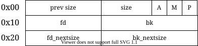

# チャンク

内部的には、確保済みか解放済みかを問わず、すべてのチャンクは [`malloc_chunk` ](https://elixir.bootlin.com/glibc/glibc-2.39/source/malloc/malloc.c#L1136)構造体として保存されています。違いは、メモリ領域の使い方にあります。

## 確保済みチャンク

`malloc()` などの関数を使って**ヒープ**から領域を確保すると、ヒープ上のアドレスへのポインタが返されます。すべてのチャンクは、使用中でも解放済みでも保持しなければならない追加の**メタデータ**を持っています。

.png>)

チャンクには 2 つの部分があります。チャンクの**メタデータ**(チャンク_についての_情報)と、実際にデータが保存される**ユーザーデータ**です。

`size` フィールドは、**メタデータを含む**チャンク全体のサイズです。これは `8` の倍数でなければならず、つまり `size` の下位 3 ビットは `0` です。この空きビットを使って、フラグ `A`、`M`、`P` が格納されます。`A` が下位から 3 番目のビット、`M` が 2 番目、`P` が最下位ビットです。

各フラグには特別な用途があります。

* `P` は [`PREV_INUSE` フラグ](https://elixir.bootlin.com/glibc/glibc-2.39/source/malloc/malloc.c#L1210)で、直前に隣接するチャンク(前方のチャンク)が使用中のときにセットされます
* `M` は [`IS_MMAPPED` フラグ](https://elixir.bootlin.com/glibc/glibc-2.39/source/malloc/malloc.c#L1243)で、`malloc()` などのヒープの仕組みではなく `mmap()` でチャンクが確保されたときにセットされます
* `A` は [`NON_MAIN_ARENA` フラグ](https://elixir.bootlin.com/glibc/glibc-2.39/source/malloc/malloc.c#L1221)で、チャンクが `main_arena` にないときにセットされます。_arena_ については後の節で扱いますが、要するに、作成された各スレッドには(上限まで)別々のarenaが与えられ、それらのarena内のチャンクには `A` ビットがセットされます

`prev_size` は、[直前に隣接するチャンクが**解放済み**の場合](https://elixir.bootlin.com/glibc/glibc-2.39/source/malloc/malloc.c#L1212)に設定されます。これは `P` が `0` であることから判断されます。解放済みでなければ、ヒープは_領域を節約_し、`prev_size` は**前のチャンクのユーザーデータ**の一部になります。解放済みの場合は、`prev_size` に前のチャンクのサイズが格納されます。

.png>)

## 解放済みチャンク

解放済みチャンクには、チャンク同士をつなぐための追加のメタデータがあります。

<figure><figcaption></figcaption></figure>

これは [`malloc_state`](https://elixir.bootlin.com/glibc/glibc-2.39/source/malloc/malloc.c#L1136) 構造体で確認できます。

```c
struct malloc_chunk {
  INTERNAL_SIZE_T      mchunk_prev_size;  /* Size of previous chunk (if free).  */
  INTERNAL_SIZE_T      mchunk_size;       /* Size in bytes, including overhead. */

  struct malloc_chunk* fd;         /* double links -- used only if free. */
  struct malloc_chunk* bk;

  /* Only used for large blocks: pointer to next larger size.  */
  struct malloc_chunk* fd_nextsize; /* double links -- used only if free. */
  struct malloc_chunk* bk_nextsize;
};
```

