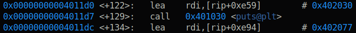

# PLT と GOT

PLT と GOT は ELF ファイル内のセクションで、**動的リンク(dynamic linking)**の大部分を担っています。CTF では、静的リンクされたバイナリよりも動的リンクされたバイナリのほうが一般的です。**動的リンク**の目的は、バイナリが実行に必要なコードをすべて自前で抱えなくてよくすることで、これによりサイズが大幅に小さくなります。代わりに、機能の大部分をシステムライブラリ(特に C 標準ライブラリである `libc`)に頼ります。\
たとえば、各 ELF ファイルが自前の `puts` をコンパイルして抱えているわけではなく、動作しているシステムの `puts` に動的にリンクします。バイナリが小さくなるだけでなく、新しいバージョンが出るたびにすべてのバイナリを再ダウンロードしなくても、ユーザーがライブラリを継続的にアップグレードできるという利点もあります。

#### では、新しいシステムでは、関数呼び出しをハードコードされたアドレスに置き換えるのでしょうか?

そうではありません。

この方法の問題は、`libc` のベースアドレスが一定、つまり実行のたびに同じメモリ領域にロードされる必要があることですが、[_**ASLR**_](https://en.wikipedia.org/wiki/Address_space_layout_randomization) が存在することを思い出してください。だからこそ_動的_リンクが必要になります。ASLR の仕組み上、これらのアドレスは_バイナリを実行するたびに_解決しなければなりません。ここで登場するのが PLT と GOT です。

## PLT と GOT

PLT(**Procedure Linkage Table**)と GOT(**Global Offset Table**)は連携してリンクを行います。

C で `puts()` を呼び出して ELF 実行ファイルとしてコンパイルすると、それは_実際には_ `puts()` ではなく、`puts@plt` としてコンパイルされます。GDB で確認してみましょう。



なぜそうなるのでしょうか?

先ほど述べたとおり、`puts` が実際にどこにあるかを知らないので、代わりに `puts` の PLT エントリへジャンプします。そこから `puts@plt` は、次のような特定の処理を行います。

* `puts` の GOT エントリがあれば、そこに格納されているアドレスへジャンプする。
* GOT エントリがなければ、解決してからそこへジャンプする。

GOT は_巨大な_アドレスのテーブルで、そのアドレスは `libc` 関数がメモリ上に実際に存在する場所です。たとえば `puts@got` には、メモリ上の `puts` のアドレスが入っています。PLT が呼ばれると GOT のアドレスを読み、実行をそこへリダイレクトします。アドレスが空の場合は、`ld.so`(**動的リンカ/ローダ(dynamic linker/loader)**とも呼ばれます)と連携して関数のアドレスを取得し、GOT に格納します。これは `_dl_runtime_resolve` を呼ぶことで行われます(詳しくは [ret2dlresolve](../ret2dlresolve/) のセクションで説明します)。

## バイナリエクスプロイトでどう役立つのか

上の説明から、重要なポイントが 2 つあります。

* 関数の PLT アドレスを呼ぶことは、その関数自体を呼ぶのと等価である
* GOT のアドレスには `libc` 内の関数のアドレスが入っており、GOT はバイナリ内にある

1 つ目の利点は明らかです。`system` のような目的の `libc` 関数の PLT エントリがあれば、そこへ実行をリダイレクトするだけで `system` を直接呼ぶのと同じことになります。`libc` の中へジャンプする必要はありません。

2 つ目はそれほど明らかではありませんが、おそらくさらに重要です。GOT はバイナリの一部なので、ベースからのオフセットは常に一定です。したがって、PIE が無効であるか、何らかの方法でバイナリのベースをリークできれば、`libc` 関数のアドレスが格納されている正確なアドレスがわかります。任意読み取り(arbitrary read)があれば、その `libc` 関数の実際のアドレスをリークするのは簡単で、ASLR をバイパスできます。

## 任意読み取りの悪用

スタックのエクスプロイトで任意読み取りを悪用する主な方法は 2 つあります。C の文字列は null で終端されるため、これらの方法では GOT エントリだけでなく、_null バイトに達するまでのそれ以外のすべて_も返されます。必要なバイト数だけを取り出すようにしてください。

### ret2plt

**ret2plt** は一般的な手法で、`puts@plt` を呼び出し、puts の GOT エントリをパラメータとして渡します。これにより `puts` は、自分自身の `libc` 内のアドレスを出力します。続けて、戻りアドレスをエクスプロイト対象の関数に設定してもう一度それを呼び出せるようにし、

```python
# 32-bit ret2plt
payload = flat(
    b'A' * padding,
    elf.plt['puts'],
    elf.symbols['main'],
    elf.got['puts']
)

# 64-bit
payload = flat(
    b'A' * padding,
    POP_RDI,
    elf.got['puts']
    elf.plt['puts'],
    elf.symbols['main']
)
```


`flat()` は、渡したすべての値を(状況に応じて)`p32()` や `p64()` でパックして連結します。そのため、パック関数をいちいち書かなくて済みます。


### %s format string

理論は同じですが、スタックの空きが限られている場合や、ROP チェーンがスタックを変化させて以降のペイロードを複雑にしてしまう場合(たとえば stack pivoting のとき)に役立ちます。

```python
payload = p32(elf.got['puts'])      # p64() if 64-bit
payload += b'|'
payload += b'%3$s'                  # The third parameter points at the start of the buffer


# this part is only relevant if you need to call the function again

payload = payload.ljust(40, b'A')   # 40 is the offset until you're overwriting the instruction pointer
payload += p32(elf.symbols['main'])

# Send it off...

p.recvuntil(b'|')                   # This is not required
puts_leak = u32(p.recv(4))          # 4 bytes because it's 32-bit
```

## まとめ

* PLT と GOT は動的リンクの大部分を担う
* PLT は、使用する関数の `libc` 内の実際の場所を解決し、GOT に格納する
  * 次にその関数が呼ばれたときは、GOT エントリのアドレスを読み、それを呼び出す
* `function@plt` を呼ぶことは、その関数自体を呼ぶのと等価である
* 任意読み取りがあれば GOT を読めるので、`libc` のベースを計算して ASLR をバイパスできる
