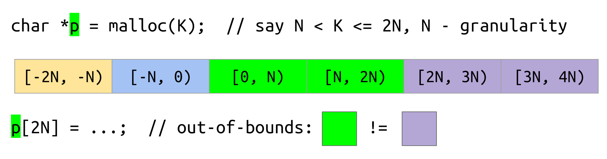

# Memory Tagging Extensions (MTE)

## Overview

[Pointer Authentication](pointer-authentication.md) と同様に、Arm はより高い安全性をもたらすハードウェアによる保護を次々と打ち出しています。MTE と呼ばれるこの機能は、メモリ安全性の脆弱性に対するハードウェアベースの防御です。

メモリ管理には、脆弱性の原因になりやすい一般的な誤りが2種類あります。

<table><thead><tr><th width="163">脆弱性の種類</th><th width="248">例</th><th>説明</th></tr></thead><tbody><tr><td>空間的安全性(Spatial Safety)</td><td>OOB access, Buffer Overflow</td><td>プログラムが確保された領域の外のメモリにアクセスする</td></tr><tr><td>時間的安全性(Temporal Safety)</td><td><a href="../../types/heap/use-after-free.md">UAF</a>, <a href="../../types/heap/double-free/">Double-Free</a></td><td>プログラムがメモリを解放した後にそのメモリへアクセスする</td></tr></tbody></table>

MTE は、「錠」と「鍵」の仕組みを使って、この両方の脆弱性を緩和することを目指しています。

## Operation: Tagging

錠と鍵の仕組みの中には、2種類のタグ付けがあります。

* **アドレスタグ(Address Tagging)**(鍵): プログラムが使うすべてのポインタの上位に4ビットの「タグ」を付加します。Arm 64ビットの機能である "top-byte-ignore" を利用するため、64ビットアプリケーションでのみ機能します
* **メモリタグ(Memory Tagging)**(錠): こちらも4ビットで構成され、アプリケーションのメモリ空間にある16バイトにアラインされた領域ごとに紐づけられます(これらの領域は **タグ粒度(tag granule)** と呼ばれます)

考え方としては、**アドレスタグ** を通じて、**メモリタグ** が **アドレスタグ** と一致する場合にのみ、**ポインタ** はその **メモリ** 領域にアクセスできます。[この講演](https://www.youtube.com/watch?v=9wRT2hNwbkA)の[スライド](https://docs.google.com/presentation/d/10V_msbtEap9dNerKvTrRAzvfzYdrQFC8e2NYHCZYJDE/edit?usp=sharing)を見てみましょう。

<figure><figcaption></figcaption></figure>

ポインタ `p` には緑のタグが付いていますが、紫のタグが付いたメモリにアクセスしようとしています。プロセッサは、ポインタのタグが紫のタグと異なることを検出し、エラーを発生させます。

<figure><figcaption></figcaption></figure>

`malloc` による最初の確保では、`2N` バイトの領域に緑のタグが付けられ、ポインタにも緑のタグが付けられます。その後、緑のポインタが解放されると、緑のメモリは赤に付け替えられます。その後に緑のポインタをふたたび使うと、プロセッサがタグの違いを検出してエラーを発生させます。

## How is MTE used?

[MTE には3つのモード](https://source.android.com/docs/security/test/memory-safety/arm-mte)があります。[**同期(Synchronous)**](https://source.android.com/docs/security/test/memory-safety/arm-mte#sync-mode)、[**非同期(Asynchronous)**](https://source.android.com/docs/security/test/memory-safety/arm-mte#async-mode)、[**非対称(Asymmetric)**](https://source.android.com/docs/security/test/memory-safety/arm-mte#asymmetric-mode)です。

* 同期モードは、バグ検出の正確さに最適化されており、オーバーヘッドが最も大きくなります。タグの不一致があると、プロセスは直ちに SIGSEGV で終了します
* 非同期モードは、性能に最適化されています。タグの不一致があっても、最も近いカーネルへのエントリまでプロセスは実行を続け、その後 SIGSEGV で終了します
* 非対称モードは、ほぼあらゆる点で非同期モードを改良したもので、**読み取り** では同期的に、**書き込み** では非同期的にチェックを行います

Android では、バグを見つけるためのテストでは SYNC モードを使い、本番環境ではオーバーヘッドが小さいことから ASYMM(プロセッサが ASYMM に対応していなければ ASYNC)を使うことを推奨しています。

MTE は非常に強力ですが、時に強力 **すぎる** ため、デフォルトで有効になっているとは限りません。不正なアクセスを含むバグだらけのアプリの多くは、静かに問題なく動作しますが、MTE を有効にするとクラッシュしてしまいます。そのため、Android でも iOS でも、ユーザーがインストールしたアプリに MTE が強制されることはありません。性能面の懸念から、Android カーネルでも MTE はデフォルトでは有効になっていません。

## Enhanced MTE

これは、Arm との協力のもと、[Apple のおかげで](https://security.apple.com/blog/memory-integrity-enforcement/) MTE に加えられた一連の改良です。これについては、[こちら](https://developer.arm.com/documentation/109697/0100/Feature-descriptions/The-Armv8-9-architecture-extension?lang=en)の **FEAT\_MTE4, Enhanced Memory Tagging Extension** の項目以外にはほとんど情報が見つかりません。これは、最新の iPhone に搭載されている Apple の新しいセキュリティ緩和策 [Memory Integrity Enforcement](memory-integrity-enforcement.md) と深く関連しています。新しい Apple Silicon チップにも搭載されると予想できます。

## Resources

* [Arm's Blog post on MTE](https://newsroom.arm.com/blog/memory-safety-arm-memory-tagging-extension)
* [Introduction to Arm MTE by Thore Göbel](https://thore.io/posts/2025/09/introduction-to-arm-memory-tagging-extensions/)
* [Apple's Security Research Team on MIE](https://security.apple.com/blog/memory-integrity-enforcement/)
